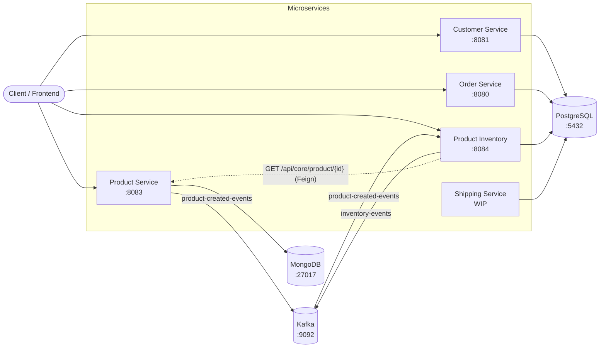

# ShopOnline

ShopOnline is an e-commerce backend built as a set of Spring Boot microservices. Each service owns its own data and exposes a REST API; services talk to each other through Kafka events and, where a synchronous answer is needed, through OpenFeign.

## Architecture



### Product created flow

1. A product is created through `POST /api/core/product`; Product Service stores it in MongoDB.
2. Product Service publishes a `ProductCreatedEvent` (`eventId`, `eventType`, `source`, `createdAt`, `productId`, `quantity`) to the `product-created-events` topic, keyed by `productId`.
3. Product Inventory consumes the event, validates it, confirms the product exists via Feign, and creates the stock record.
4. Redelivered events are ignored (stock already exists for that `productId`). Invalid events, or events for unknown products, go to `product-created-events.DLT`; transient failures are retried twice first.

## Services

| Service | Folder | Port | Storage | Description |
|---|---|---|---|---|
| Customer Service | `customerService/customerService` | 8081 | PostgreSQL `shopOnline` | Customer registration and profile management |
| Order Service | `OrderService/OrderService` | 8080 | PostgreSQL `shopOnline` | Orders and order items |
| Product Service | `product-service/product-service` | 8083 | MongoDB `shopOnline` | Product catalog and categories; publishes product events |
| Product Inventory | `product-inventory/product-inventory` | 8084 | PostgreSQL `ecomm_inventory_db` | Stock levels; consumes product events, publishes inventory events |
| Shipping Service | `shipping-service/shipping-service` | — | PostgreSQL | Shipping (work in progress, skeleton only) |

## Tech stack

- Java 17, Spring Boot 4.0
- Spring Web MVC, Spring Data JPA, Spring Data MongoDB
- Apache Kafka (Spring for Apache Kafka)
- Spring Cloud OpenFeign
- PostgreSQL, MongoDB
- Lombok, Jakarta Validation
- springdoc-openapi (Swagger UI)
- Maven (wrapper included in each service)

## API overview

### Customer Service — `http://localhost:8081`
| Method | Path | Description |
|---|---|---|
| POST | `/api/customers` | Create a customer |
| GET | `/api/customers` | List customers |
| GET | `/api/customers/{id}` | Get a customer |
| PUT | `/api/customers/{id}` | Update a customer |
| DELETE | `/api/customers/{id}` | Delete a customer |

### Order Service — `http://localhost:8080`
| Method | Path | Description |
|---|---|---|
| POST | `/api/orders` | Create an order |
| GET | `/api/orders` | List orders |
| GET | `/api/orders/{orderId}` | Get an order |
| PUT | `/api/orders/{orderId}` | Update an order |
| DELETE | `/api/orders/{orderId}` | Delete an order |
| POST | `/api/orders/{orderId}/items` | Add an item to an order |
| GET | `/api/orders/{orderId}/items` | List items of an order |
| PUT | `/api/order-items/{itemId}` | Update an order item |
| DELETE | `/api/order-items/{itemId}` | Delete an order item |

### Product Service — `http://localhost:8083`
| Method | Path | Description |
|---|---|---|
| POST | `/api/core/product` | Create a product (publishes `ProductCreatedEvent`) |
| GET | `/api/core/product?page=0&size=20` | List products, newest first |
| GET | `/api/core/product/{id}` | Get a product |
| POST | `/api/core/category` | Create a category |
| GET | `/api/core/category` | List categories |
| GET | `/api/core/category/roots` | List root categories |
| GET | `/api/core/category/{id}` | Get a category |
| PUT | `/api/core/category/{id}` | Update a category |
| DELETE | `/api/core/category/{id}` | Delete a category |

### Product Inventory — `http://localhost:8084`
| Method | Path | Description |
|---|---|---|
| POST | `/api/core/inventory` | Create stock for a product |
| GET | `/api/core/inventory/{productId}` | Get stock for a product |
| PUT | `/api/core/inventory/{productId}/add` | Add stock |
| PUT | `/api/core/inventory/{productId}/reduce` | Reduce stock |
| GET | `/api/core/inventory/{productId}/in-stock` | Check availability |

Swagger UI is available at `/swagger-ui.html` on services that include springdoc (Customer and Product Service).

## Kafka topics

| Topic | Producer | Consumer | Payload |
|---|---|---|---|
| `product-created-events` | Product Service | Product Inventory | `ProductCreatedEvent` |
| `product-created-events.DLT` | Product Inventory (error handler) | — | Failed `ProductCreatedEvent` records |
| `inventory-events` | Product Inventory | Product Inventory | `InventoryEvent` (`STOCK_CREATED`, `STOCK_ADDED`, `STOCK_REDUCED`) |

Topics are created automatically on startup.

## Getting started

### Prerequisites

- JDK 17+
- Docker (for Kafka)
- PostgreSQL on `localhost:5432` with databases `shopOnline` and `ecomm_inventory_db`
- MongoDB on `localhost:27017`

### 1. Start Kafka

```bash
cd product-service/product-service
docker compose up -d
```

This starts a single-node Kafka broker (KRaft mode) on `localhost:9092`.

### 2. Configure databases

Each service reads its connection settings from `src/main/resources/application.properties`. The defaults assume a local PostgreSQL user `postgres`; update the username and password to match your setup.

### 3. Run the services

From each service folder:

```bash
./mvnw spring-boot:run        # macOS / Linux
mvnw.cmd spring-boot:run      # Windows
```

Start Product Service before Product Inventory, since the inventory service calls it to verify products.

### 4. Try the product → inventory flow

```bash
curl -X POST http://localhost:8083/api/core/product \
  -H "Content-Type: application/json" \
  -d '{"name":"Keyboard","sku":"KB-001","price":49.99,"currency":"USD","stockInQuantity":25,"active":true}'

# a moment later, stock exists in the inventory service
curl http://localhost:8084/api/core/inventory/<productId>
```

## Project structure

```
ShopOnline/
├── customerService/customerService/      Customer Service
├── OrderService/OrderService/            Order Service
├── product-service/product-service/      Product Service (+ docker-compose.yml for Kafka)
├── product-inventory/product-inventory/  Product Inventory Service
└── shipping-service/shipping-service/    Shipping Service (WIP)
```

## Roadmap

- Implement Shipping Service
- Publish order events and reserve stock on order placement
- API gateway and service discovery
- Externalize credentials via environment variables
- Docker Compose for the full stack
